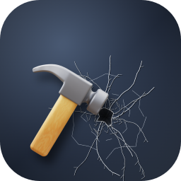

# Молоток — плагин Agents Hub

Разбейте экран хаба, как в Desktop Destroyer / Desktop Toys: кнопка «Молоток» в верхней полосе — у курсора 3D-молоток.
Клик — три кадра удара (замах, смазанный взмах, удар), в точке удара — пробоина в стекле: тёмная дыра с рваным краем,
крошево, трещины; отлетают осколки, звенит стекло. Частые клики — каждый бьёт. Esc или «Убрать осколки» — всё как было.

- Это прозрачный слой поверх страницы: хаб под ним работает, пока молоток в руке, клики до хаба не доходят.
- Звук — синтезирован в браузере (Web Audio), файлов и сети нет.
- «Уменьшить движение» в системе — без кадров взмаха и осколков, только пробоины.

## Поставить

«Настройки» → «Плагины» → найдите «hammer» → «Проверить и поставить» (или хабу: «поставь плагин молоток»).
Вручную: `hub market add flagman` и `hub market install flagman/hub-plugin-hammer`.

## Как устроен

`hub-plugin.json` — манифест (имя, иконка, что делает и зачем, API `^1.0`), `main.js` — плагин страницы: кнопка в
месте `topbar` через `hub.addSlot`, остальное — canvas поверх страницы: спрайт молотка (`hammer.png`) и спрайты пробоин (рисуются один раз при
открытии), `icon.png` — иконка. Без зависимостей.

Молоток — 3D-иконка «hammer» от [Icons8](https://icons8.com) (стиль 3D Fluency).

Лицензия — MIT.
